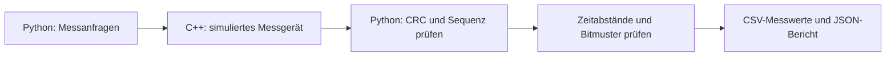

# Measurement Testbench

Ein ausführbares C++-/Python-Projekt für eine simulierte Messkette:
Messwerte anfordern, Antworten prüfen, Zeitfehler erkennen und Ergebnisse
als CSV und JSON speichern.

Das Projekt ist eine unabhängige Demonstration mit vollständig synthetischen
Daten und einem eigens definierten Beispielprotokoll. Es enthält keine
Institutssoftware, Abschlussarbeitsdaten oder Gerätekonfigurationen.



## Was sich demonstrieren lässt

- C++17-Komponente mit definierten Protokollantworten und CRC-Prüfung.
- Unabhängig implementierter Python-Client gegen einen echten C++-Prozess.
- Wiederholbare Fehlerinjektion und Prüfung der gesamten Messkette.
- Integer-Zeitstempel, Toleranzgrenzen und vorsichtige Interpretation konstanter Bits.
- GoogleTest, pytest und ein Workflow für Windows und Linux.

## Voraussetzungen

- CMake ab 3.24 und Git.
- C++17-Compiler: lokal mit Visual Studio 2022/MSVC geprüft.
- Python 3.12.
- Internet beim ersten Konfigurieren für GoogleTest 1.17.0 und beim Installieren
  von pytest 9.1.1. Der Simulator und der Client benötigen danach keine
  Netzwerkverbindung; der Client verwendet nur die Python-Standardbibliothek.

## Bauen und testen

Alle Befehle werden im Repository-Hauptverzeichnis ausgeführt.

```sh
cmake -S . -B build
cmake --build build --config Release --parallel 2
ctest --test-dir build -C Release --output-on-failure
python -m venv .venv
```

Bei einem Generator ohne mehrere Konfigurationen, etwa Unix Makefiles,
im ersten Befehl zusätzlich `-DCMAKE_BUILD_TYPE=Release` angeben.

Windows PowerShell:

```powershell
.\.venv\Scripts\python.exe -m pip install -r requirements-dev.txt
.\.venv\Scripts\python.exe -m pytest tests/python -q
```

Linux:

```sh
.venv/bin/python -m pip install -r requirements-dev.txt
.venv/bin/python -m pytest tests/python -q
```

Die Python-Integrationstests erwarten den zuvor gebauten Simulator in
`build/bin/sensor_sim.exe` unter Windows beziehungsweise `build/bin/sensor_sim`
unter Linux. Fehlende Binärdateien führen zum Testfehler, nicht zum Überspringen.

## Vollständige Demo

Windows:

```powershell
python -m client.run --simulator build/bin/sensor_sim.exe --scenario clean --output out/clean
python -m client.run --simulator build/bin/sensor_sim.exe --scenario corrupt --output out/corrupt
```

Linux verwendet dieselben Befehle mit `build/bin/sensor_sim` ohne `.exe`.

Jeder Lauf fordert 16 Messwerte an und erzeugt:

- `samples.csv`: akzeptierte Sequenznummern, Zeitstempel in Ticks und Rohwerte.
- `report.json`: fehlende Sequenzen, Übertragungsfehler, Zeitabweichungen,
  konstante Bits und `timing_and_transport_pass`.

Ein erneuter Lauf im selben Ausgabeordner überschreibt diese beiden Dateien.

| Szenario | Eingebrachte Änderung |
| --- | --- |
| `clean` | Keine |
| `jitter` | Zeitstempel der Sequenz 5 um 200 Ticks erhöht |
| `duplicate` | Zeitstempel der Sequenz 5 auf den vorherigen Wert gesetzt |
| `missing` | Antwort auf Sequenz 5 ausgelassen |
| `corrupt` | Ein Nutzdatenbit der Antwort 5 nach der CRC-Berechnung verändert |
| `stuck-low` | Bit 7 aller Zeitstempel auf 0 gesetzt, jeweils mit gültiger CRC |

Der Sollabstand beträgt 1000 Ticks, die erlaubte Abweichung 50 Ticks.
Die Zeitwerte sind Modellwerte und keine Messung der Prozesslaufzeit.
Der synthetische Rohwert lautet `1000 + 3 * sequence` und hat keine
physikalische Einheit.

Exitcodes:

- `0`: Transport- und Timingprüfungen bestanden.
- `1`: Messlauf abgeschlossen, Auffälligkeiten gefunden. Bei den Fehlerszenarien
  ist das das erwartete Ergebnis.
- `2`: Lauf nicht ausführbar, beispielsweise Simulator fehlt oder beendet sich
  nicht innerhalb von zehn Sekunden.

Ein konstantes Bit allein macht `timing_and_transport_pass` nicht falsch.
Auch regelmäßige Integer-Zeitstempel können konstante Bits enthalten.

## Aufbau

| Datei | Verantwortung |
| --- | --- |
| [`src/protocol.cpp`](src/protocol.cpp) | CRC, Antworten, synthetische Messwerte und Fehler |
| [`src/simulator.cpp`](src/simulator.cpp) | Hex-Zeilen über Standardein-/ausgabe |
| [`client/protocol.py`](client/protocol.py) | Python-Kodierung und Prüfung der Antworten |
| [`client/timestamp_check.py`](client/timestamp_check.py) | Zeitabstände, Abweichungen und konstante Bits |
| [`client/run.py`](client/run.py) | C++-Prozess starten, Ergebnisse prüfen und speichern |
| [`tests/`](tests/) | C++- und Python-Tests einschließlich Integration |

Das vollständige Frameformat und die Fehlercodes stehen in
[`docs/protocol.md`](docs/protocol.md).

Im JSON-Bericht beziehen sich Timing-Indizes auf die Liste der akzeptierten
Samples, beginnend bei 0. `accepted_sequences` ordnet diese Positionen den
Protokoll-Sequenznummern zu. Das ist bei einer fehlenden Antwort relevant.

## Prüfung und Grenzen

Die Tests prüfen den CRC-Referenzwert, gültige und fehlerhafte Requests,
alle Fehlerinjektionen, die Python-/C++-Kommunikation, Reportdateien,
Exitcodes, Toleranzgrenzen und große Zeitstempel.
Der [Workflow](.github/workflows/tests.yml) konfiguriert Builds und Tests für
`windows-2022` und `ubuntu-24.04`.
Am 20.10.2026 bestanden lokal unter Windows mit MSVC 19.44 und Python 3.12.10
acht GoogleTest-Fälle und 30 pytest-Fälle. Alle sechs Demo-Szenarien wurden
ausgeführt. Ein GitHub-CI-Lauf und ein Linux-Lauf wurden damit noch nicht bestätigt.

- Die Transporthülle übergibt vollständige Frames als Hex-Zeilen.
  Ein UART-Treiber, Byte-Stream-Resynchronisation und Wiederholversuche sind
  nicht implementiert.
- Das Beispiel steuert keine Kamera, keinen FPGA und keine Drohne.
  Hardware-, Flug- oder Echtzeitvalidierung wird nicht beansprucht.
- Stuck-Bit-Kandidaten und Zeitlücken zeigen Beobachtungen, keine eindeutige
  Fehlerursache. Zählerüberläufe werden markiert und nicht korrigiert.
- CRC erkennt bestimmte Übertragungsfehler; sie authentifiziert keinen Absender.
- Die acht Bit breiten Sequenznummern werden pro Lauf einmal verwendet;
  ein längerer fortlaufender Betrieb mit Sequenzüberlauf ist nicht modelliert.
- Der Datensatz wird vollständig im Speicher verarbeitet.

## English

A complete synthetic measurement demo: a Python client requests readings from a
C++17 simulator, checks frame CRCs and sequence numbers, analyses timestamps,
and writes CSV/JSON reports. Six deterministic scenarios cover clean data and
injected transport or timing faults. GoogleTest and pytest exercise the C++
component and the cross-language pipeline. The project does not include real
instrument software or measurement data.

## Lizenz / License

[MIT](LICENSE), Copyright (c) 2026 Nabwei Elfakhrany.
